# FreshCheck

<p align="center">
  <b>Visual Produce-Quality Classification with EfficientNet-B0</b>
</p>

<p align="center">
  
  
  
  
  
</p>

---

## Overview

FreshCheck is a computer-vision MVP for **visual produce-quality classification**. The current classifier predicts one of five dataset-defined visual labels:

- **Damaged**
- **Dried**
- **Old**
- **Ripe**
- **Unripe**

The current champion is **EfficientNet-B0**, trained and evaluated on the mounted VegNet quality-classification data used by this project.

The mounted dataset contains four crop groups:

- Bell Pepper
- Chile Pepper
- New Mexico Green Chile
- Tomato

> **Claim boundary:** FreshCheck predicts visible appearance categories only. It does **not** determine food safety, microbial contamination, chemical freshness, remaining shelf life, or whether produce is safe to consume.

---

## Project Status

**Portfolio progress:** `12%`

```text
Dataset inspection
→ dataset audit
→ class/crop analysis
→ duplicate & leakage checks
→ train/validation/test split
→ EfficientNet-B0 training
→ held-out test evaluation
→ per-class / per-crop analysis
→ qualitative failure review
→ Streamlit app
→ saved inference results
```

---

## Before → Now → Next

### Before

- public produce-quality dataset;
- no project-specific audit;
- no verified mounted sample count;
- no duplicate/leakage check;
- no trained project champion;
- no per-crop evaluation;
- no local app;
- no explicit claim boundaries.

### Now

FreshCheck currently has:

- audited mounted dataset;
- fixed class mapping;
- fixed crop mapping;
- readable-image audit;
- exact-duplicate audit;
- label-conflict audit;
- cross-split hash-leakage audit;
- fixed train/validation/test split;
- EfficientNet-B0 champion;
- final held-out test metrics;
- per-class report;
- per-crop report;
- correct/failure prediction assets;
- Streamlit local app;
- automatic local inference saving;
- machine-readable reports.

### Next

1. automated tests;
2. external-domain evaluation;
3. confidence calibration;
4. better app UX;
5. batch inference;
6. ONNX export;
7. CPU benchmark;
8. Docker/FastAPI deployment;
9. additional crop species;
10. robustness tests across lighting, camera, background, and variety.

---

## Problem

Visual produce-quality inspection can be subjective. People may interpret the same produce differently based on color, texture, wrinkling, bruising, visible damage, apparent age, and apparent ripeness.

FreshCheck therefore focuses on a narrow and measurable question:

> **Which dataset-defined visual-quality category most closely matches the uploaded produce image?**

This project does not replace laboratory or food-safety inspection.

---

## Product Goal

Given one produce image, FreshCheck should:

1. preprocess it consistently with training;
2. run EfficientNet-B0 inference;
3. predict one visual-quality class;
4. show confidence;
5. show Top-3 predictions;
6. expose class probabilities;
7. save an inference artifact locally;
8. preserve prediction history for testing/review.

---

## Non-Goals

FreshCheck currently does **not** provide:

- food-safety determination;
- microbial contamination detection;
- chemical freshness analysis;
- shelf-life prediction;
- edible/non-edible decisions;
- nutritional analysis;
- produce weight estimation;
- universal fruit/vegetable quality assessment;
- commercial grading outside the dataset labels.

---

## Architecture

```text
Produce image
    ↓
Resize + normalization
    ↓
EfficientNet-B0
    ↓
5-class logits
    ↓
Softmax probabilities
    ↓
Top-1 + Top-3 + confidence
    ↓
Streamlit UI
    ↓
tests/results/
```

---

## Class Mapping

```text
0 = Damaged
1 = Dried
2 = Old
3 = Ripe
4 = Unripe
```

The class order must remain identical across training, evaluation, checkpoint loading, and local inference.

---

## Supported Crop Mapping

```text
0 = Bell Pepper
1 = Chile Pepper
2 = New Mexico Green Chile
3 = Tomato
```

The application may technically accept arbitrary images, but validation currently covers the crop groups represented in the mounted dataset.

---

# Dataset

## Source

Dataset family:

```text
Project-AgML/VegNet_quality_classification
```

Mounted project parquet used during the experiment:

```text
/kaggle/input/datasets/loliwibu/vegnet/data/train-00000-of-00001.parquet
```

The raw dataset is not redistributed in this repository.

The mounted conversion is treated as the operational source of truth for this experiment.

---

## Mounted Dataset Audit

Mounted rows:

```text
6,150
```

Columns:

```text
image
label
crop_type
```

### Quality-Class Distribution

| Label | Class | Samples |
|---:|---|---:|
| 0 | Damaged | 317 |
| 1 | Dried | 1,389 |
| 2 | Old | 2,044 |
| 3 | Ripe | 1,787 |
| 4 | Unripe | 613 |
| **Total** |  | **6,150** |

### Crop Distribution

| Crop ID | Crop | Samples |
|---:|---|---:|
| 0 | Bell Pepper | 1,176 |
| 1 | Chile Pepper | 1,286 |
| 2 | New Mexico Green Chile | 1,327 |
| 3 | Tomato | 2,361 |
| **Total** |  | **6,150** |

### Integrity Audit

```text
Readable images          = 6,150
Unreadable images        = 0
Exact duplicates         = 0
Label conflicts          = 0
Cross-split hash leakage = 0
```

### Final Split

| Split | Samples |
|---|---:|
| Train | 4,305 |
| Validation | 922 |
| Test | 923 |
| **Total** | **6,150** |

---

## Dataset Evidence

### Dataset Quality Examples

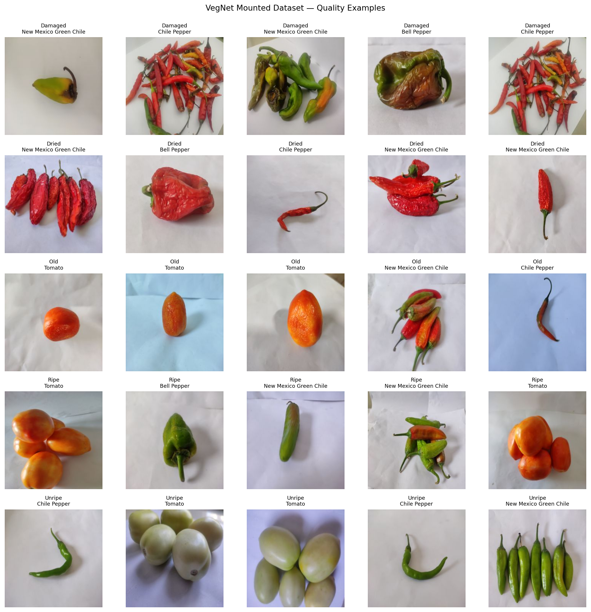

### Quality-Class Distribution

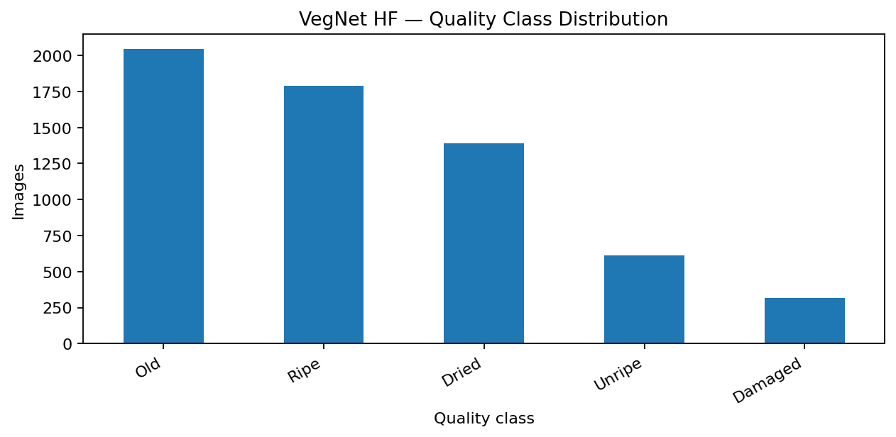

### Crop Distribution

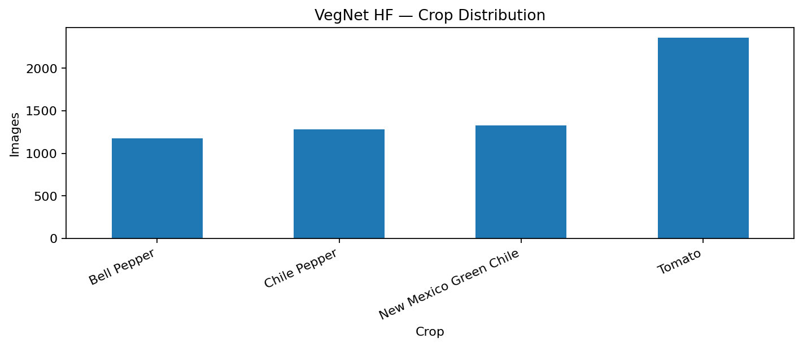

### Crop × Quality Distribution

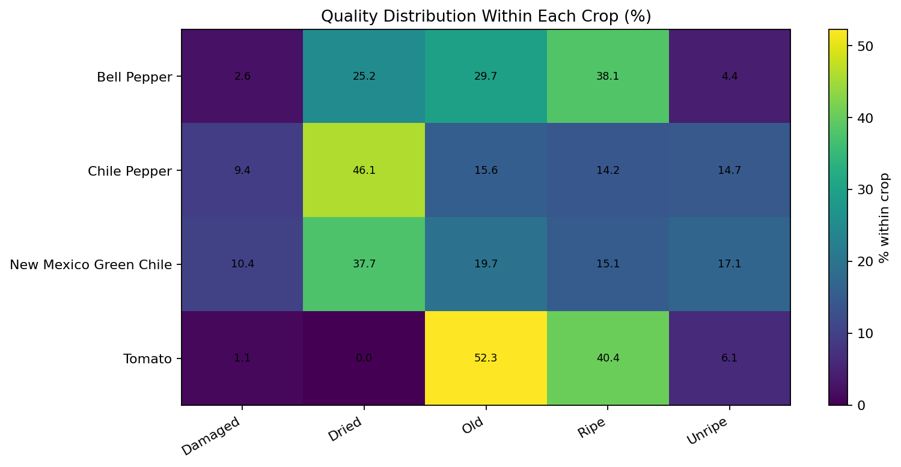

---

# Experiment

## Champion Model

```text
EfficientNet-B0
```

Checkpoint:

```text
models/freshcheck_effnet_b0_best.pt
```

Best validation checkpoint:

```text
Epoch 8
```

Training history:

```text
reports/training_history.csv
```

---

## Training Evidence

### Training Loss

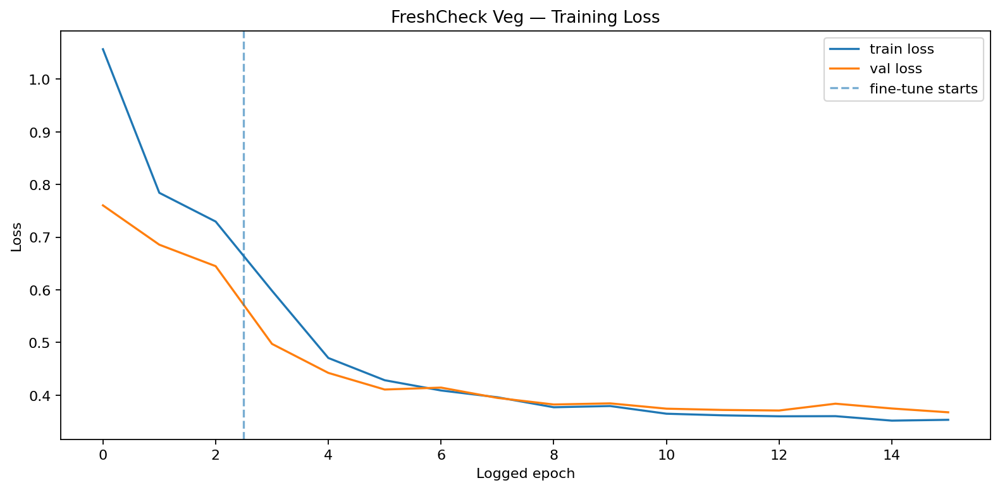

### Training Macro F1

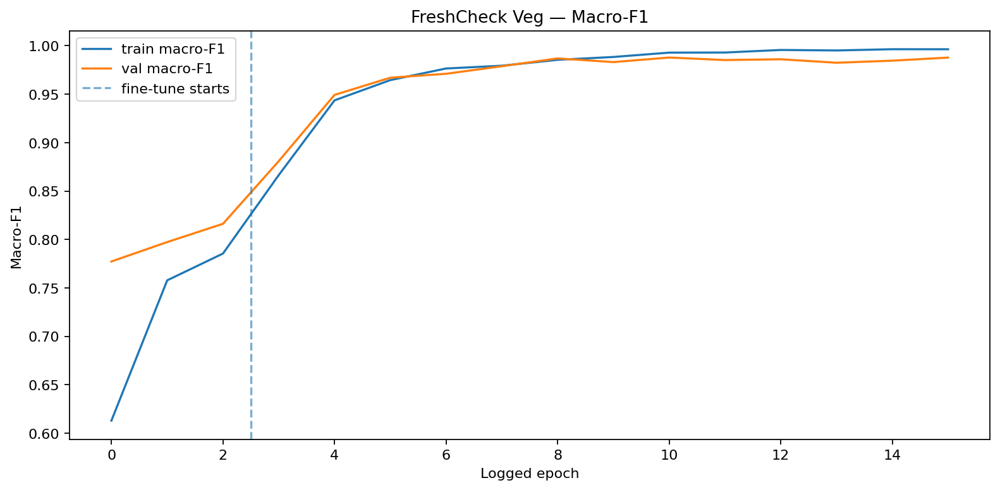

---

# Final Held-Out Test

| Metric | Value |
|---|---:|
| Accuracy | **99.46%** |
| Balanced Accuracy | **99.64%** |
| Macro F1 | **99.57%** |

Weakest class F1:

```text
≈ 99.25%
```

These metrics describe the project's **internal held-out test split**. They are not universal real-world performance guarantees.

---

## Per-Crop Performance

| Crop | Result |
|---|---:|
| Bell Pepper | 99.44% |
| Chile Pepper | 100.00% |
| New Mexico Green Chile | 97.98% |
| Tomato | 100.00% |

---

## Evaluation Evidence

### Confusion Matrix

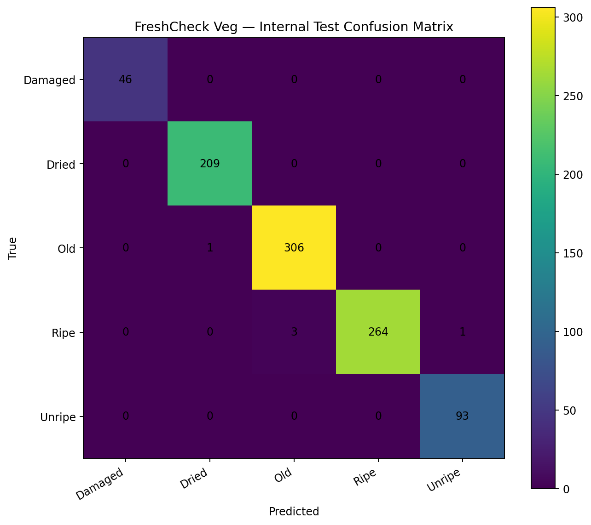

### Normalized Confusion Matrix

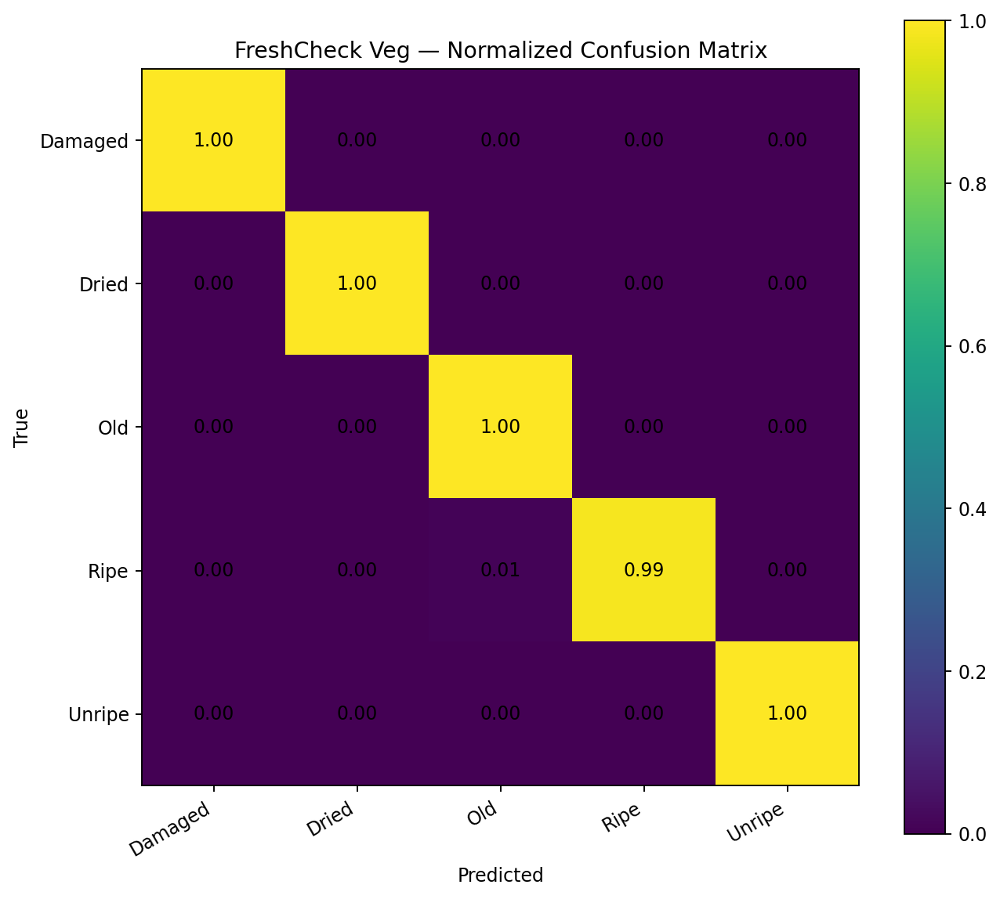

### Macro F1 by Crop

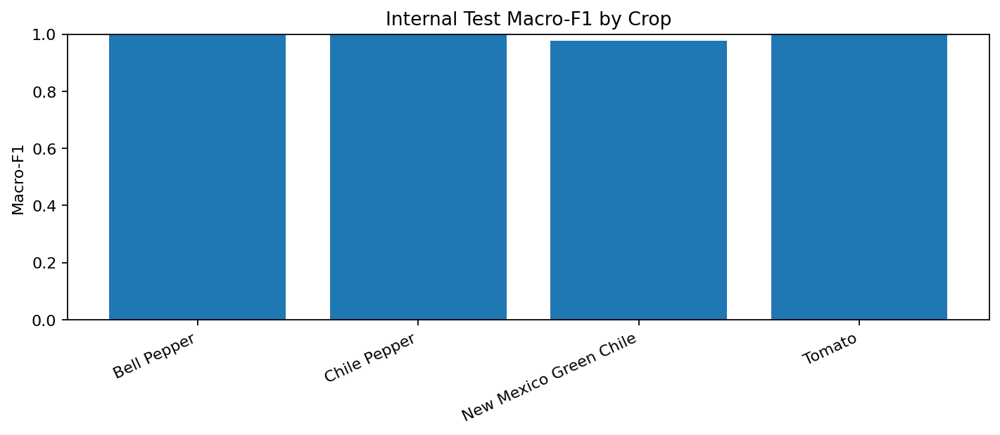

---

## Qualitative Evidence

### Correct Predictions

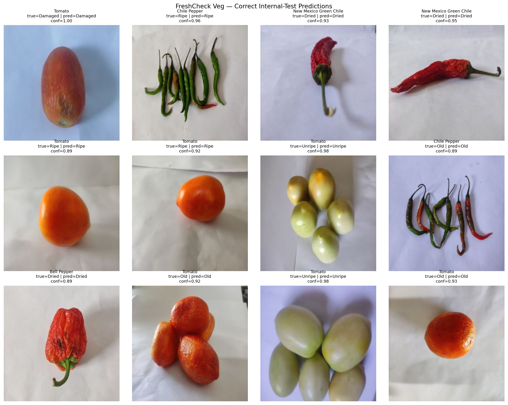

### Failure Cases

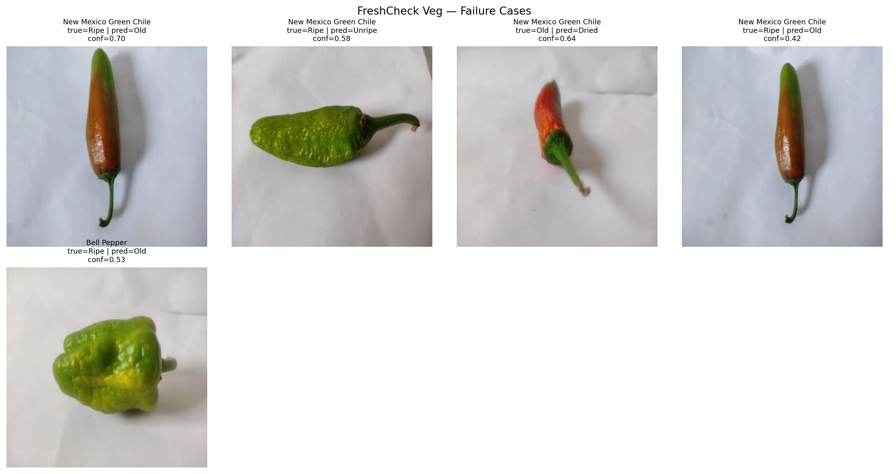

Failure cases are intentionally preserved. Strong aggregate metrics do not mean every image is easy or every external image will generalize.

---

# Streamlit App

Current flow:

```text
Upload image
→ preprocess
→ EfficientNet-B0
→ predicted class
→ confidence
→ Top-3 predictions
→ probability chart
→ save result
```

Current features:

- image upload;
- Top-1 prediction;
- confidence score;
- confidence-level display;
- full probability distribution;
- Top-3 predictions;
- prediction history;
- automatic local result saving;
- interpretation warning.

---

## Saved Inference Results

Generated inference output is stored in:

```text
tests/results/
```

Typical output:

```text
tests/results/
├── 20261019_XXXXXX_ripe_prediction.jpg
├── 20261019_XXXXXX_ripe_result.json
└── prediction_history.csv
```

Generated results are local test artifacts by default.

Selected portfolio examples should be intentionally copied into `assets/screenshots/` or `assets/predictions/` before committing them.

---

# Inference Configuration

Local inference metadata is stored in:

```text
reports/inference_config.json
```

The local pipeline should remain consistent with training for:

- class order;
- image size;
- normalization mean;
- normalization standard deviation;
- architecture.

A preprocessing change is a model-interface change and must be retested.

---

# Installation

## Clone

```bash
git clone https://github.com/MENSTRUE/FreshCheck-Fruit.git
cd FreshCheck-Fruit
```

## Virtual Environment

### Windows PowerShell

```powershell
python -m venv .venv
.\.venv\Scripts\Activate.ps1
```

### Linux/macOS

```bash
python3 -m venv .venv
source .venv/bin/activate
```

## Dependencies

```bash
pip install -r requirements.txt
```

## Verify Model

```text
models/freshcheck_effnet_b0_best.pt
```

## Run

```bash
streamlit run app/app.py
```

or:

```bash
python -m streamlit run app/app.py
```

Typical local URL:

```text
http://localhost:8501
```

---

# Inference API

Reusable inference wrapper:

```text
src/inference.py
```

Example:

```python
from PIL import Image
from src.inference import FreshCheckClassifier

classifier = FreshCheckClassifier()

image = Image.open("example.jpg")

result = classifier.predict(
    image,
    source_name="example.jpg",
)

print(result.predicted_class)
print(result.confidence)
print(result.top3)
```

Save result:

```python
result = classifier.save_result(
    original_image=image,
    result=result,
)
```

---

# Repository Structure

```text
FreshCheck-Fruit/
├── app/
│   └── app.py
├── assets/
│   ├── dataset/
│   │   ├── crop_distribution.png
│   │   ├── crop_quality_distribution_heatmap.png
│   │   ├── dataset_quality_examples.png
│   │   └── quality_class_distribution.png
│   ├── evaluation/
│   │   ├── test_confusion_matrix.png
│   │   ├── test_confusion_matrix_normalized.png
│   │   └── test_macro_f1_by_crop.png
│   ├── predictions/
│   │   ├── test_correct_predictions.png
│   │   └── test_failure_cases.png
│   ├── screenshots/
│   └── training/
│       ├── training_loss.png
│       └── training_macro_f1.png
├── models/
│   └── freshcheck_effnet_b0_best.pt
├── notebooks/
│   └── freshcheck_fruit.ipynb
├── reports/
│   ├── dataset_audit.json
│   ├── final_summary.json
│   ├── inference_config.json
│   ├── split_manifest.csv
│   ├── test_classification_report.csv
│   ├── test_per_crop_metrics.csv
│   ├── test_predictions.csv
│   └── training_history.csv
├── src/
│   ├── __init__.py
│   ├── inference.py
│   └── utils.py
├── tests/
│   ├── results/
│   │   └── .gitkeep
│   └── test_inference.py
├── .gitignore
├── AGENTS.md
├── LICENSE
├── README.md
└── requirements.txt
```

---

# Source of Truth

Use this precedence for public claims:

```text
1. reports/final_summary.json
2. reports/test_classification_report.csv
3. reports/test_per_crop_metrics.csv
4. reports/dataset_audit.json
5. reports/split_manifest.csv
6. reports/training_history.csv
7. reports/inference_config.json
8. notebooks/freshcheck_fruit.ipynb
9. README.md
```

If README conflicts with machine-readable reports, investigate the reports first.

---

# Claim Boundaries

## Supported

- visual produce-quality classification;
- five-class classification;
- EfficientNet-B0;
- mounted VegNet internal benchmark;
- local Streamlit MVP.

Supported benchmark claims:

```text
Accuracy          ≈ 99.46%
Balanced Accuracy ≈ 99.64%
Macro F1          ≈ 99.57%
```

## Unsupported

Do not claim:

- 99.46% universal freshness accuracy;
- food-safety detection;
- edible/unsafe classification;
- microbial detection;
- chemical freshness;
- remaining shelf life;
- universal fruit classifier;
- universal vegetable classifier;
- commercial-grade quality inspection;
- production reliability across unseen environments.

---

# Reproducibility

Preserve the chain:

```text
dataset source
→ mounted conversion
→ dataset audit
→ split manifest
→ training history/config
→ checkpoint
→ test report
→ per-crop report
→ inference config
```

Key artifacts:

```text
reports/dataset_audit.json
reports/split_manifest.csv
reports/training_history.csv
reports/test_classification_report.csv
reports/test_per_crop_metrics.csv
reports/final_summary.json
reports/inference_config.json
```

---

# Testing

Recommended test coverage:

- checkpoint existence;
- checkpoint load;
- five-class output dimension;
- class order;
- config parsing;
- valid image inference;
- invalid image handling;
- probability sum ≈ 1;
- Top-1 equals maximum probability;
- Top-3 ordering;
- CPU inference;
- result image saving;
- JSON saving;
- history append;
- Streamlit import smoke test.

Unit tests should use tiny fixtures and should not require the full dataset.

---

# Deployment

Current supported deployment mode:

```text
Local Python + Streamlit
```

Future targets:

- Streamlit Community Cloud;
- Docker;
- FastAPI;
- ONNX Runtime;
- CPU inference service;
- edge deployment.

Deployment performance must be re-measured on target hardware.

---

# Limitations

## Model

- five dataset-defined classes only;
- only four crop groups represented;
- visual appearance only;
- different background/lighting/camera may shift predictions;
- unusual produce varieties may be out-of-domain;
- confidence can be high even on incorrect or out-of-domain inputs.

## Dataset

- internal split metrics may overestimate external generalization;
- class distribution is imbalanced;
- public-source versions may differ from the mounted conversion;
- visual labels are not laboratory measurements.

## Product

- local MVP;
- no database;
- no authentication;
- no production API;
- no monitoring;
- no drift detection;
- no active learning;
- no calibrated out-of-distribution detector.

---

# Responsible Use

FreshCheck is currently a:

```text
portfolio / research MVP
```

Do not use it as the sole basis for:

- food disposal;
- health/safety decisions;
- legal quality certification;
- shelf-life decisions;
- commercial acceptance/rejection.

---

# Roadmap

## Data

- [x] mounted dataset audit
- [x] readable-image check
- [x] duplicate check
- [x] conflict check
- [x] split leakage check
- [x] class/crop distributions
- [ ] external image benchmark
- [ ] multiple cameras/lighting
- [ ] additional crop species
- [ ] domain-shift benchmark

## Model

- [x] EfficientNet-B0 champion
- [x] held-out test
- [x] Macro F1
- [x] Balanced Accuracy
- [x] per-crop metrics
- [x] failure review
- [ ] confidence calibration
- [ ] alternative backbones
- [ ] ONNX
- [ ] quantization

## Product

- [x] Streamlit app
- [x] upload
- [x] Top-1
- [x] Top-3
- [x] probability chart
- [x] prediction history
- [x] local result saving
- [ ] download result
- [ ] batch inference
- [ ] example gallery
- [ ] mobile layout

## Testing

- [ ] unit tests
- [ ] integration tests
- [ ] preprocessing regression test
- [ ] checkpoint compatibility test
- [ ] app smoke test
- [ ] GitHub Actions CI

## Deployment

- [ ] Docker
- [ ] FastAPI
- [ ] ONNX Runtime
- [ ] CPU benchmark
- [ ] cloud deployment
- [ ] monitoring

---

# Troubleshooting

## Model Not Found

Expected:

```text
models/freshcheck_effnet_b0_best.pt
```

## Missing PyTorch/TorchVision

```bash
pip install -r requirements.txt
```

## Streamlit Command Not Found

```bash
python -m streamlit run app/app.py
```

## Prediction Labels Look Wrong

Verify class order:

```text
0 Damaged
1 Dried
2 Old
3 Ripe
4 Unripe
```

A class-order mismatch can display the wrong label even if the model output index is correct.

## Healthy-Looking Tomato Predicted as `Old`

Possible causes:

- domain shift;
- background/lighting difference;
- variety difference;
- preprocessing mismatch;
- learned visual similarity to `Old` examples.

First verify `reports/inference_config.json` and ensure local preprocessing matches training.

## High Confidence but Wrong Prediction

Softmax confidence is not an out-of-distribution detector. A classifier can be confidently wrong.

## Generated Results Not Appearing in Git

`tests/results/` is intended for temporary generated inference artifacts. Move selected evidence into `assets/screenshots/` or `assets/predictions/` before intentionally committing it.

---

# FAQ

## Is `Ripe` the same as `Healthy`?

No. `Ripe` is a dataset-defined visual label.

## Is `Old` automatically spoiled?

No. It describes visual appearance, not food safety.

## Does `Damaged` mean unsafe to eat?

No.

## Can FreshCheck estimate shelf life?

No.

## Can it detect bacteria or chemical spoilage?

No.

## Why are internal metrics so high?

The held-out split is very well classified, and the audit found no exact duplicate/hash leakage across splits. That still does not prove external-domain performance.

## Does 99.46% accuracy mean 99.46% real-world accuracy?

No.

## Why Macro F1?

The classes are imbalanced. Macro F1 gives each class equal weight.

## Why Balanced Accuracy?

It reduces dominance by majority classes by averaging class recall.

## Why per-crop evaluation?

Overall performance can hide a weaker produce group.

## Can I upload any fruit?

Technically yes, but validation currently covers only the represented crop groups. Other produce should be considered out-of-domain.

---

# Reports and Artifacts

| Artifact | Purpose |
|---|---|
| `dataset_audit.json` | mounted dataset integrity |
| `split_manifest.csv` | split assignment |
| `training_history.csv` | training progress |
| `test_classification_report.csv` | per-class metrics |
| `test_per_crop_metrics.csv` | per-crop evaluation |
| `test_predictions.csv` | per-sample test predictions |
| `final_summary.json` | public source of truth |
| `inference_config.json` | inference/preprocessing contract |

---

# Technology Stack

- Python
- PyTorch
- TorchVision
- EfficientNet-B0
- NumPy
- Pandas
- Pillow
- Matplotlib
- Streamlit
- Kaggle
- Git
- GitHub

---

# License

Project source code is released under the **MIT License**.

Dataset rights are separate from the repository's source-code license.

FreshCheck does not relicense the original VegNet dataset.

---

# Author

**Wafa Bila Syaefurokhman**

GitHub: https://github.com/MENSTRUE

Repository: https://github.com/MENSTRUE/FreshCheck-Fruit

---

# Final Statement

FreshCheck demonstrates an end-to-end workflow:

```text
understand the mounted data
→ audit labels and duplicates
→ preserve split integrity
→ train a measurable classifier
→ evaluate held-out data
→ inspect class and crop behavior
→ retain failure cases
→ reproduce preprocessing
→ expose the model through an app
```

FreshCheck is intentionally positioned as a **visual produce-quality classification MVP**, not a food-safety or shelf-life system.
